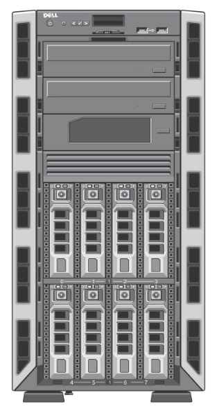

# Dell PowerEdge T320

Dell Generation 12 tower format server.

[PowerEdge T320 Owner's Manual](https://dl.dell.com/topicspdf/poweredge-t320_owners-manual_en-us.pdf)



## iDRAC Console

### HTML5

This server has iDRAC 7. If possible I would recommend using the HTML console. In iDRAC go to `Server > Virtual Console > Type` and change it from `Java` to `HTML5`.

### Java

If the HTML5 console is not a possibility for you, the Java console requires a quite obsolete version of it to run. You may not want to install such an obsolete java version in your system so you may want to use one of the following links to get a zipped non-installable distribution:

- [Oracle JDK 8u421 x64 from Adobe](https://cfdownload.adobe.com/pub/adobe/coldfusion/java/java8/java8u421/jdk/jdk-8u421-windows-x64.zip)
- [Oracle JDK 8u421 x86 from Adobe](https://cfdownload.adobe.com/pub/adobe/coldfusion/java/java8/java8u421/jdk/jdk-8u421-windows-i586.zip)

To launch the viewer you may run the following command:

```pwsh
.\jdk1.8.0_421\bin\javaws.exe -wait '.\viewer.jnlp'
```

## Life cycle updates

One may find updates in the corresponding [Dell support webpage](https://www.dell.com/support/product-details/es-es/product/poweredge-t320/drivers) but they force you to manually download files and upload them to iDRAC one by one.

Alternatively, an awesome guy called Kenneth Finnegan, has setup a mirror server with updates for these obsolete machines at <https://updateyodell.net/>.

The configuration for this model would be as follows:

| Setting       | Value                |
| ------------- | -------------------- |
| File location | FTP                  |
| Address       | ftp.updateyodell.net |
| Username      | dell                 |
| Password      | calvin               |
| Path          | g12                  |

## Power supplies

Systems with redundant power supplies come with 495 W or 750 W hot plug units.
In redundant mode the system has 750 W in total, not 1500 W, because a single unit must be able to carry the whole load.

To check which units are installed:

```sh
sudo ipmitool fru print                  # Look for "PWR SPLY,495W,RDNT,..." or "PWR SPLY,750W,RDNT,..."
sudo ipmitool sdr type "Power Supply"    # Presence, "AC lost" and redundancy status
```

If you want to replace your PSUs, replace both power supplies! Do not mix 495 W and 750 W units!

Compatible part numbers:

| Generation | Power | Dell P/N                                        | Fits |
| ---------- | ----- | ----------------------------------------------- | ---- |
| 12th       | 750 W | 5NF18, 6W2PW, N30P9, 79RDR, 9PXCV, F9F51, W0CTF | Yes  |
| 13th       | 750 W | 5RHVV, 0XW8W, TPJ2X, XTVK2                      | No   |


## Mods

### Additional hard disk bays

One may use the 5.25" bays to install extra hard drive caddies.

Beware that it is not easy to obtain additional power cables for those drives and that we will be loading the existing power rails over their limits if we are not careful enough.

Consult the owner's manual before proceeding. This system does not support more than one internal RAID controller. For this reason, you may need to use expander cards or flash extra cards in IT mode.

Finally, you may need to acquire some hard drive controllers.

Caddies:

- [OImaster MR-6601](https://aliexpress.com/item/1005005545723632.html)

Cursed power cable adapters:

- [OULLX male SATA to dual Molex](https://aliexpress.com/item/4000138991016.html)

HDD controllers:

- [Dell PERC H310](../raid_controllers/Dell_PERC_H310.md)

### GPU

The T320 fits one full height GPU in slot 3, its only PCIe 3.0 x16 slot. Dell only validated the NVIDIA Quadro 4000 and 6000, but other cards work if they stay within the power and cooling limits.

Power:

- Up to 75 W: cards powered only by the slot need no extra parts. Passive datacenter cards (Tesla P4, T4) need extra airflow.
- Up to about 225 W: cards with power connectors need the [750 W power supplies](#power-supplies) and these Dell parts:

| Part             | Dell P/N | Notes                                  |
| ---------------- | -------- | -------------------------------------- |
| GPU power cable  | 3692K    | PDB 8-pin to PCIe 8+6-pin (T620 cable) |
| PCIe card holder | 5HJGD    | Supports a full length card            |

Setup:

- Keep the onboard Matrox video as the primary display. The iDRAC virtual console uses it.
- Datacenter cards (Tesla and similar) may need `Memory Mapped I/O above 4 GB` enabled in the BIOS `Integrated Devices` menu. Consumer and workstation cards need no BIOS changes.
